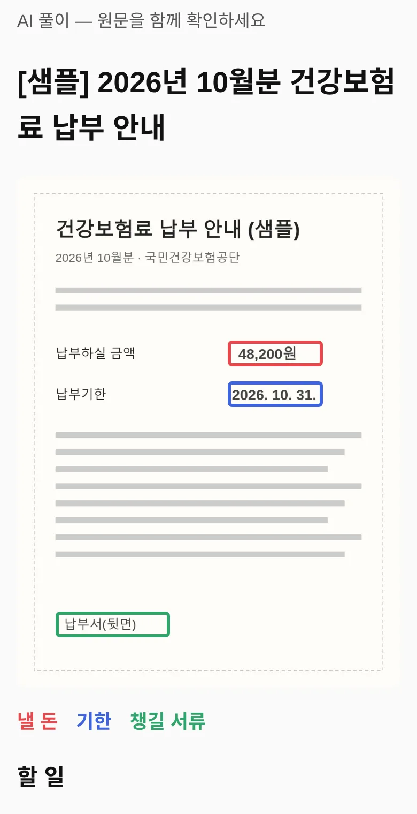
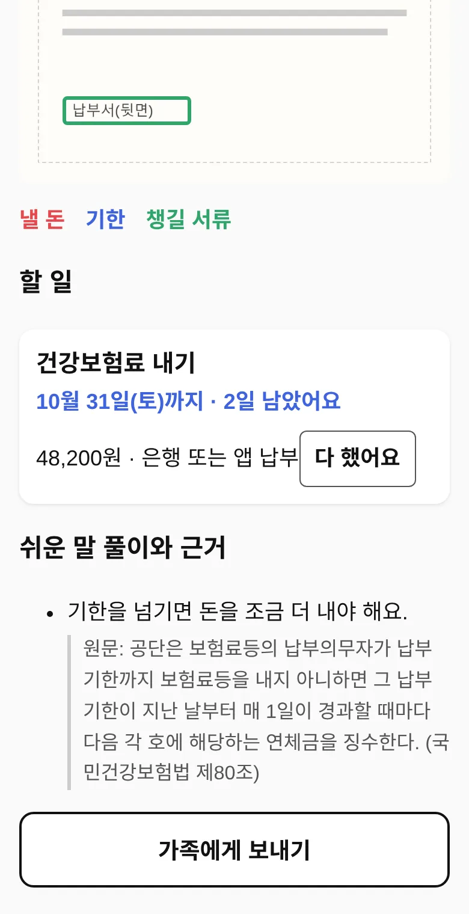
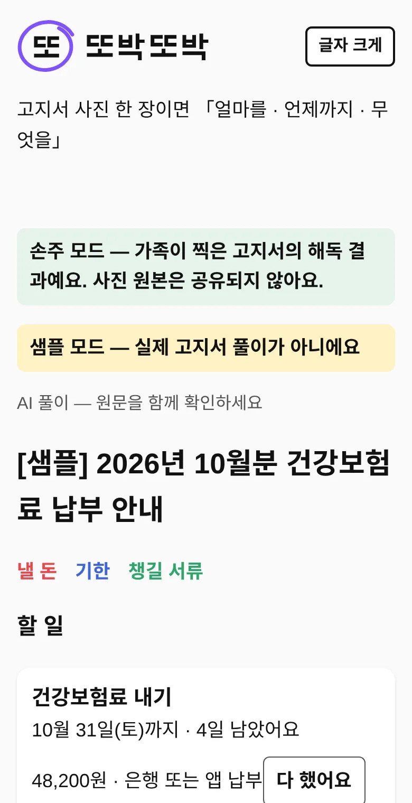
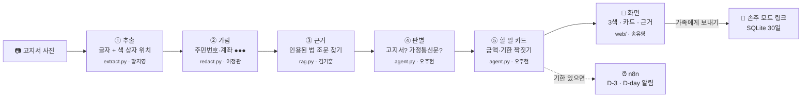
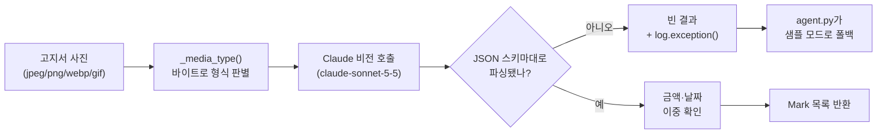

<div align="center">

<picture>
  <source media="(prefers-color-scheme: dark)" srcset="assets/brand/ttobak-horizontal-dark.svg">
  
</picture>

### 고지서 사진 한 장이면 「얼마를 · 언제까지 · 무엇을」

고지서를 찍으면 낼 돈·기한·챙길 서류에 색을 칠하고, 쉬운 말로 할 일을 알려 주는 AI 서비스

[](http://129.225.184.224:8037/app/)
[](http://129.225.184.224:8037/)


-e5484d)

[한눈에 보기](#-한눈에-보기) · [화면](#-화면) · [어떻게 동작하나요](#-어떻게-동작하나요) · [지금 되는 것](#-지금-되는-것과-아직인-것) · [팀](#-팀원-및-역할) · [따라 하기](#따라-하기) · [용어 사전](#용어-사전)

</div>


코디세이 AI 네이티브 대전 **M3 AI 네이티브 Final Project 자율 주제** 팀 저장소예요.

## 🧒 한눈에 보기

건강보험료 고지서를 받은 어르신이 「이거 얼마를 언제까지 내라는 거니?」 하고 묻는 순간을 위한 서비스예요.
고지서 사진을 올리면 사진 위에 **낼 돈(빨강) · 기한(파랑) · 챙길 서류(초록)** 상자를 그리고,
「10월 31일까지 48,200원 내기」처럼 **할 일 하나를 카드 한 장**으로 보여 줘요.

**왜 만들었나요?** 고지서·가정통신문·주민센터 안내문을 받고도 「그래서 뭘 해야 하지?」 하는 분이 많아요.
한자어(납부·체납·경과 시), 법 조항 인용, 앞뒷면·표에 흩어진 날짜와 금액 때문이에요.
**누구를 위해?** 1차 사용자는 대전의 60대 이상 어르신과 그 자녀예요.

| 받은 종이에는 | 또박또박은 |
|---|---|
| 「납부기한 경과 시 연체금이 가산됩니다」 | 「기한을 넘기면 돈을 조금 더 내야 해요」 |
| 표 안 어딘가의 `48,200` | 사진 위 **빨간 상자** + 「48,200원」 카드 |
| 아래쪽 작은 글씨 `2026. 10. 31.` | 사진 위 **파란 상자** + 「10월 31일(토)까지 · 4일 남았어요」 |
| 「국민건강보험법 제80조에 따라」 | 그 조문 **원문을 그대로** 붙인 근거 |
| 혼자 보고 끝 | **[가족에게 보내기]**로 자녀에게 링크 공유 |

## 📱 화면

| ① 사진 위에 3색 표시 | ② 할 일 카드와 근거 | ③ 손주 모드(가족이 받은 링크) |
|:---:|:---:|:---:|
|  |  |  |
| 상자를 누르면 그 자리 글자가 펼쳐져요 | 기한이 가까운 순서, 3일 이내면 파랑 · 지나면 빨강 | 사진은 빼고 결과만 30일 보관해요 |

> [!NOTE]
> 캡처는 **샘플 모드**(가짜 고지서 1건)로 찍었어요. 진짜 고지서 사진은 개인정보라 저장소에 올리지 않아요.
> 배포 서버는 비전 LLM 키가 있어서 실제 사진을 해독해요.

## 🧭 어떻게 동작하나요

사진 한 장이 다섯 단계를 차례로 거쳐요 — 글자 읽기 → 개인정보 가리기 → 법 찾기 → 종류 고르기 → 할 일 만들기.



| 단계 | 하는 일 | 왜 이렇게? |
|---|---|---|
| ① 추출 | 비전 LLM이 사진을 보고 글자와 「돈·날짜·서류」 위치를 JSON으로 줘요 | 자유 문장으로 받으면 상자를 못 그려요 |
| ② 가림 | 주민번호·계좌번호를 가려요 | 뒤 단계·화면·공유 링크에는 가린 글자만 가요 |
| ③ 근거 | 고지서에 적힌 「○○법 제○조」의 진짜 조문을 찾아 붙여요 | 원문 인용이 없는 풀이는 버려요 — 틀리면 돈을 잃으니까요 |
| ④ 판별 | 고지서·가정통신문·안내문·신청서 중 무엇인지 골라요 | 신청서면 「답장 필요」를 켜요 |
| ⑤ 할 일 | 표시를 「언제까지 · 얼마 · 어떻게」 카드로 묶어요 | 할 일마다 카드가 따로 있어 하나씩 끝내기 쉬워요 |

> [!IMPORTANT]
> **금액·날짜는 한 번 더 맞춰 봐요.** AI가 뽑은 값을, 같은 AI가 읽어 낸 고지서 전체 글자와 다시 맞춰 보고 어긋나면 그 상자는 그리지 않아요.
> 틀린 색칠보다 빈칸이 안전하기 때문이에요. 다만 사진을 다른 방법으로 다시 읽는 건 아니라서, 돈·날짜는 꼭 **받은 고지서와 직접** 확인해 주세요.
> 자세한 건 아래 「추출 모듈 이야기」에 있어요.

## ✅ 지금 되는 것과 아직인 것

[docs/02-기능명세.md](docs/02-기능명세.md)의 「구현 현황」을 옮겼어요(배포 `d9e8075` 기준).

| | 기능 | 지금 |
|:---:|---|---|
| ✅ | 사진 올리기 | 찍거나 고르기, 큰 사진은 줄여서 보내기, 기다리는 동안 몇 초 지났는지 표시 |
| ✅ | 개인정보 가림 | 추출 뒤 근거·화면·공유 전에 주민번호·계좌번호를 가려요 |
| ✅ | 3색 빨간펜 | 사진 크기에 맞춘 비율 좌표로 상자를 그리고, 누르면 글자가 펼쳐져요 |
| ✅ | 할 일 카드 | 기한이 가까운 순서, 3일 이내면 파랑 · 지나면 빨강, 「다 했어요」 기록 |
| ✅ | 손주 모드 | 사진 없이 해독 결과만 30일 보관하는 링크 |
| ✅ | 기한 알림 | 실제 해독 결과에 기한이 있으면 n8n으로 D-3·D-day 알림(서버에 웹훅이 있을 때) |
| ✅ | 글자 크게 · 요청 제한 | 맨 위 버튼으로 글자 키우기, 1분에 너무 자주 올리면 「N초 뒤에 다시」 안내 |
| △ | 근거 찾기 | 고지서에 조문 번호가 적혀 있을 때만 찾아요. 비슷한 내용 검색은 아직이에요 |
| △ | 문서 종류 판별 | 낱말(납부·가정통신·신청)로만 골라요. LLM 판별로 바꿀 예정이에요 |
| ✗ | 답장 초안 | 「답장 필요」 표시만 해요. 답장 문장은 아직 비어 있어요 |

> [!WARNING]
> **아직 재지 못한 것** — 테스트셋 30장 정확도(목표 90%)와 어르신 사용자 테스트(5명 이상)는 아직이에요.
> 숫자가 생기기 전에는 빈칸으로 둬요. 지어낸 결과·피드백으로 채우지 않아요.

## 👥 팀원 및 역할

| 이름 | 역할 | 한 줄로 | 내 파일 | GitHub |
|------|------|---------|---------|--------|
| 오주현(팀장) | PM · AI Agent | 일정·PR 리뷰·통합, 다섯 단계의 순서(Agent)와 결과 모양(JSON) | `backend/app/agent.py` · `schema.py` | [@dicia-jhoh](https://github.com/dicia-jhoh) |
| 황지영 | 멀티모달 추출 | 사진에서 글자·색 상자 위치를 뽑고 금액·날짜를 본문 글자와 대조 | `backend/app/extract.py` | [@ppungee-maker](https://github.com/ppungee-maker) |
| 이정관 | Backend · 배포 · 자동화 | FastAPI 서버, 개인정보 가림, 공유 링크, OCI 배포, n8n 기한 알림 | `backend/app/main.py` · `automation/` | [@ljk-cidy](https://github.com/ljk-cidy) |
| 송유영 | Frontend | 모바일 화면, 3색 표시, 할 일 카드, 손주 모드 | `web/` | [@youyu10012-glitch](https://github.com/youyu10012-glitch) |
| 김기훈 | RAG 데이터 · 품질 | 법 조문 모으기와 근거 찾기, 테스트셋 30장, 정확도 | `backend/app/rag.py` · `data/` | [@duplgabszin](https://github.com/duplgabszin) |
| 송유진 | UX 라이팅 · 사용자 테스트 | 쉬운 말 가이드, 화면 문구·접근성, 어르신 테스트, 발표 자료 | `docs/04`~`06` · `web/` 문구 | [@youjinni11](https://github.com/youjinni11) |

누가 무엇을 했는지는 커밋·PR에 남아요([CONTRIBUTING.md](CONTRIBUTING.md)). 홈페이지의 팀 칸과 PR 목록은 `content/members/<내 id>.js`에서 와요 — 역할이 바뀌면 그 파일과 이 표를 같이 고쳐요.

## 🧩 필수 기술 요소 (2개 이상 → 4개)

| 기술 요소 | 사용 | 어디에 |
|---|:---:|---|
| 멀티모달 AI | ✅ | 사진 속 표·도장·뒷면을 읽고 좌표까지 (`backend/app/extract.py`) |
| RAG (검색 증강 생성) | ✅ | 고지서가 인용한 조문 원문을 근거로 (`backend/app/rag.py`) |
| AI Agent | ✅ | 추출 → 가림 → 근거 → 판별 → 할 일, 알림 도구 호출 (`backend/app/agent.py`) |
| 자동화 워크플로우 | ✅ | n8n D-3·D-day 알림 (`automation/n8n/`) |
| Long-term Memory | ☐ | 쓰지 않아요 — 고지서는 개인정보라 저장할수록 위험해요 |

## 🛠 기술 스택 — 선택과 이유

| 영역 | 선택 | 대안 | 선정 이유 |
|---|---|---|---|
| AI | 비전 LLM API — Gemini(`gemini-flash-lite-latest`) 또는 Claude, **키 모양으로 고름** | OCR 엔진 + 텍스트 LLM | 사진 이해와 좌표 추출을 한 번에 해요. 배포 서버는 무료 한도가 넉넉한 Gemini를 써요 |
| Backend | Python FastAPI | Flask | A 과정의 Python 그대로, 입력·출력 모양을 Pydantic으로 고정해요 |
| RAG | Chroma + 조문 원본 JSONL | Pinecone | 설치가 가볍고 법령 수천 건 규모에 충분해요. 원본은 `data/legal/articles.jsonl` |
| 공유 저장 | SQLite (30일, 최대 1000개) | Redis | 서버 재시작에도 링크가 살아 있고 파일 하나로 끝나요 |
| Frontend | HTML · CSS · JS(모바일 우선) | React | 어르신이 앱 설치 없이 링크 하나로 열고, 빌드도 필요 없어요 |
| 배포 | OCI 서버 + systemd | Render · Vercel | 화면과 API를 주소 하나로 내보내요(무료, 잠들지 않음) |
| 자동화 | n8n | 직접 짠 스케줄러 | B1-3 노코드 자동화에서 쓴 도구라 알림 흐름을 바로 짜요 |

## 🔬 추출 모듈 이야기 — `backend/app/extract.py` (황지영)

> [!NOTE]
> 아래는 황지영이 이슈 [#13](https://github.com/dicia-jhoh/codyssey-m3-final/issues/13)을 고치며 남긴 기록이에요. 그 뒤(10-21)부터 배포 서버는 Gemini 키로 실제 사진을 해독해요.

<details>
<summary><b>펼쳐 보기</b> — 동작 순서 · 예시 출력 · 테스트 · 겪은 버그 · 알려진 한계</summary>

고지서 사진 한 장이 `Mark` 목록(3색 표시 좌표)으로 바뀌는 곳. 계약은
`def extract(image: bytes, api_key: str) -> tuple[str, list[Mark]]` 하나뿐이고,
`Mark`는 [docs/02-기능명세.md](docs/02-기능명세.md) 「데이터 모델」의 `schema.py`가 정본이다.



**동작 순서**
1. 사진 바이트의 헤더로 실제 형식(JPEG/PNG/WebP/GIF)을 판별해 `media_type`에 정확히 넣는다
   (`_media_type()`) — 하나로 고정해두면 폰 스크린샷(PNG)이 API에서 거절당한다.
2. 비전 LLM에 사진을 보낸다 — `LLM_API_KEY`가 Google AI Studio 키(`AIza…`·`AQ.…`)면 Gemini
   (`gemini-flash-lite-latest`), 아니면 Claude. 두 쪽 다 같은 system prompt를 쓰고, 그 prompt가 출력 형식을 JSON 스키마 하나로 강제한다
   (`document_text` 본문 전체 + `items`: `kind`(money/deadline/document)·`text`·`value`·`bbox`).
   자유 문장으로 받으면 좌표를 못 쓰므로, 스키마를 벗어나면 그대로 실패 취급한다.
3. **금액·날짜 이중 확인** — money/deadline 항목의 `value`를, 같은 호출이 돌려준
   `document_text` 본문과 정규식으로 다시 대조한다. 날짜는 `2026.10.31`(전체 숫자형)과
   `10월 31일`(연도 없는 형식, 실제 공문에 흔함) 둘 다 인식한다. 대조에서 어긋나거나
   달력에 없는 값(13월 등)이면 그 `Mark`를 아예 만들지 않고 뺀다 — 화면에서 그 칸만
   색이 안 칠해지는 게 「직접 확인 필요」 상태다. `document` 종류(챙길 서류)는 금액·날짜가
   아니라서 이중 확인 대상이 아니다.
4. 비전 호출이 실패하거나 응답이 스키마를 안 따르면 `("", [])`을 돌려준다 —
   `agent.py`가 이를 보고 자동으로 샘플 모드로 넘어간다(이 모듈은 예외를 던지지 않는다).
   실패 원인은 `log.exception()`으로 남긴다(아래 「겪은 버그」 참고).

**예시 출력** — "2026년 자동차세 납부고지서, 금 48,200원, 2026.10.31까지" 한 장을
넣으면 `extract()`가 대략 이런 걸 돌려준다(문서 전체 텍스트는 생략):
```python
(
    "2026년 자동차세 납부고지서\n납부금액: 금 48,200원\n납부기한: 2026.10.31까지\n...",
    [
        Mark(kind="money", text="금 48,200원", value="48200", bbox=[0.62, 0.18, 0.30, 0.06]),
        Mark(kind="deadline", text="2026.10.31까지", value="2026-10-31", bbox=[0.62, 0.26, 0.30, 0.06]),
    ],
)
```
`value`는 항상 다루기 쉬운 형태(금액=숫자 문자열, 날짜=`YYYY-MM-DD`)로 정규화된다 —
화면(`web/`)이나 `agent.py`의 할 일 카드 생성이 파싱을 다시 안 해도 되게 하려는 것.

**수동으로 검증해보기** — 실제 `LLM_API_KEY`가 있으면 `agent.py`/샘플 모드를 거치지 않고
이 모듈만 바로 돌려볼 수 있다.
```bash
cd backend
LLM_API_KEY=sk-... python -m app.extract <고지서사진.jpg>
```

**테스트**: `backend/tests/test_extract.py` — 실제 API 호출 없이 동작한다.
`_call_vision`을 통째로 가짜로 바꾼 파이프라인 테스트(JSON 파싱, 이중 확인, 성공/실패
경로, CLI 인자 처리)에 더해, `Anthropic` 클라이언트 자체를 가짜로 바꿔서
`messages.create`에 실제로 넘어가는 `model`·`media_type` 값까지 검증한다 — 아래 버그가
바로 그 검증이 없어서 안 잡혔던 종류다.

**겪은 버그 (이슈 [#13](https://github.com/dicia-jhoh/codyssey-m3-final/issues/13))**:
PR #9가 머지된 뒤 테스트는 전부 통과했지만, 실제 고지서 사진으로는 **검증된 적이
없었다** — `extract()`가 모든 예외를 삼키고 조용히 빈 결과를 내도록 설계돼 있어서
(샘플 모드 폴백용) 실패해도 겉으로는 멀쩡해 보일 수 있는 구조였다.
- **확인된 원인**: `media_type`이 `"image/jpeg"`로 고정돼 있어 PNG 사진이 API에서
  거절됨
- **예방 조치**: 모델 ID를 현행 `claude-sonnet-5-5`로 올림 — 옛 ID(`claude-sonnet-5`)가
  실제로 실패 원인이었는지는 미확인(공식 문서상 legacy지만 아직 Active)

PM(오주현)이 코드 리뷰에서 짚어 이슈로 올려줬고, PR #15에서 고쳤다. 실제 API 키로
돌려 본 사람은 아직 아무도 없다. 이 경험 때문에 3번(로그)과 4번(실제 호출값 검증
테스트)을 같이 추가했다 — 다음엔 같은 종류의 실패가 조용히 묻히지 않게.

**알려진 한계**: 고쳤지만 실제 `LLM_API_KEY`로 end-to-end 재검증은 아직 못 했다(위
CLI로 아무나 바로 해볼 수 있음). 김기훈의 테스트셋(`data/testset/`)이 모이면 그걸로
실제 정확도를 재야 기능 명세의 "90% 이상" 기준 충족 여부를 알 수 있다. HEIC(아이폰
기본 사진 형식)는 Claude API가 안 받아서 `_media_type()`이 명확한 에러로 거부한다
(조용히 JPEG로 속여 보내던 예전 버그는 고침) — 업로드 단계에서의 실제 변환은 아직 미구현.

관련 PR: [#9](https://github.com/dicia-jhoh/codyssey-m3-final/pull/9) 기본 구현 ·
[#10](https://github.com/dicia-jhoh/codyssey-m3-final/pull/10) 날짜 형식 보강 ·
[#11](https://github.com/dicia-jhoh/codyssey-m3-final/pull/11) 수동 검증 CLI ·
[#14](https://github.com/dicia-jhoh/codyssey-m3-final/pull/14) PR #11 base 정정 ·
[#15](https://github.com/dicia-jhoh/codyssey-m3-final/pull/15) 모델ID·이미지형식 버그 수정
(전부 merged)

</details>

## 준비물

- Python 3.11 이상 (`python3 --version`으로 확인)
- Git, 그리고 이 저장소에 초대된 GitHub 계정(초대 메일에서 수락)
- 웹 브라우저(크롬 권장)
- LLM API 키는 **없어도 돼요** — 없으면 샘플 모드(가짜 고지서 1건)로 끝까지 돌아요. 진짜 해독을 시험할 때만 `backend/.env`에 `LLM_API_KEY=...`를 넣고 3번에 `--env-file .env`를 붙여요(커밋 금지). Google AI Studio 키(`AIza…`)면 Gemini, 그 밖이면 Claude로 가요.

## 따라 하기

1. 저장소를 받아요. 아래 명령은 내 컴퓨터에 폴더 하나를 만들어요.
   ```bash
   git clone https://github.com/dicia-jhoh/codyssey-m3-final.git
   cd codyssey-m3-final
   ```
2. 백엔드를 설치하고 테스트를 돌려요. 가상환경(`.venv`)을 만들어 이 프로젝트 전용으로 설치해요.
   ```bash
   cd backend
   python3 -m venv .venv
   source .venv/bin/activate          # Windows: .venv\Scripts\activate
   pip install -r requirements.txt
   pytest                             # 전부 passed 면 성공(지금 150개)
   ```
3. 백엔드 서버를 띄워요. 켜 두면 <http://localhost:8000/docs>에서 API를 눌러 볼 수 있어요.
   ```bash
   uvicorn app.main:app --reload
   # 진짜 해독: uvicorn app.main:app --reload --env-file .env   (앱은 .env 를 직접 읽지 않아요)
   ```
4. 브라우저로 <http://localhost:8000/app/>을 열어요. 아무 사진이나 올리면 샘플 해독 결과가 나와요.
   백엔드가 서비스 화면(`web/`)과 팀 홈페이지(http://localhost:8000/)도 같이 내줘요. 화면(`web/`)을 고치면 새로고침만 하면 돼요.
   지난 기한 화면은 `http://localhost:8000/app/?today=2026-11-05`로 봐요(이 날짜 바꾸기는 샘플 모드에서만 적용돼요).
5. 홈페이지만 고칠 땐 백엔드 없이 저장소 맨 위 폴더에서 띄워도 돼요. 그다음 <http://localhost:8001>을 열어요.
   ```bash
   python3 -m http.server 8001
   ```
6. 내 일을 시작해요. 브랜치를 만들고, 위 「내 파일」을 고치고, PR을 올려요.
   - 규칙: [CONTRIBUTING.md](CONTRIBUTING.md)
   - 배정된 이슈를 고치는 순서: [docs/07-이슈-해결하는-법.md](docs/07-이슈-해결하는-법.md)
   - 이슈마다 찾을 글·바꿀 글을 복붙만 하면 되는 풀이: [docs/08-이슈-풀이-따라하기.md](docs/08-이슈-풀이-따라하기.md)

## 🚀 배포

| 대상 | 주소 |
|---|---|
| 서비스 화면 | http://129.225.184.224:8037/app/ |
| 팀 홈페이지 | http://129.225.184.224:8037/ |
| 서버 상태(배포 커밋) | http://129.225.184.224:8037/health |

배포 방법과 새 버전 올리기는 [deploy/README.md](deploy/README.md). 화면·API·홈페이지가 **주소 하나(포트 하나)**로 나가요.

## 📚 문서 지도

| 산출물 | 위치 | 지금 |
|---|---|---|
| 기획서 | [docs/01-기획서.md](docs/01-기획서.md) · 제출본 [PDF](docs/plan/상세기획서-또박또박.pdf) | 확정 |
| 기능 요구 명세서·아키텍처 | [docs/02-기능명세.md](docs/02-기능명세.md) | 구현 현황 표까지 |
| AI 설계(프롬프트·Agent·RAG) | [docs/03-AI-설계.md](docs/03-AI-설계.md) | 코드 순서와 맞춤 |
| 사용자 테스트(5명 이상) | [docs/04-사용자테스트.md](docs/04-사용자테스트.md) | 설계·동의서 — 테스트 전 |
| 발표 자료 | [docs/05-발표.md](docs/05-발표.md) | 슬라이드 순서·시연 대본 |
| 쉬운 말 가이드 | [docs/06-쉬운말-가이드.md](docs/06-쉬운말-가이드.md) | 바꿔 쓰기 표·화면 문구 점검 |
| 이슈 해결법 · 풀이 | [docs/07](docs/07-이슈-해결하는-법.md) · [docs/08](docs/08-이슈-풀이-따라하기.md) | 팀원 이슈마다 |
| 서비스 | `backend/` · `web/` | 배포됨(실제 해독) |

## 🛡 AI 윤리

- 모든 풀이 화면에 **「AI 풀이 — 원문을 함께 확인하세요」**를 표시해요.
- 주민등록번호·계좌번호는 비전 LLM이 글자를 읽은 **뒤**, 근거 찾기·화면·공유 링크로 넘기기 전에 가려요(`backend/app/redact.py`). 사진 자체는 가리기 전에 LLM으로 가요.
- 사진 원본은 처리가 끝나면 지워요. 손주 모드 링크엔 사진 없이 해독 결과만 30일 남아요. 실물 고지서 사진은 저장소에 올리지 않아요(`data/testset/images/`는 `.gitignore`).
- 「다 했어요」 기록은 서버가 아니라 그 핸드폰 브라우저에만 남아요.
- 사용자 테스트 기록에는 실명 대신 `사용자 1`처럼 적어요.
- 이 저장소의 문서·코드 초안은 AI(Claude)가 쓰고 팀이 검토했어요. AI가 쓴 부분은 커밋·PR에 적어요.

## 🗂 저장소 구조

폴더마다 무엇이 있는지예요. 처음엔 `web/`(화면)과 `backend/app/`(서버)만 알면 돼요.

```
backend/                FastAPI — app/(main·agent·schema·extract·redact·rag·share·notify·sample), tests/
web/                    서비스 화면(모바일 웹, 빌드 없음) — 백엔드가 같이 내준다
deploy/                 OCI 배포(systemd 서비스 파일, 절차)
automation/n8n/         기한 알림 워크플로우
data/legal/             근거로 붙이는 법 조문 원본(articles.jsonl)
data/testset/           고지서 테스트셋 라벨(사진은 커밋하지 않는다)
docs/                   미션 산출물 문서, plan/ = 제출한 기획서 원본, img/ = 이 README 캡처
index.html · assets/ · content/   팀 홈페이지(빌드 없음) — 로고 키트·사용 가이드 = assets/brand/
```

## 용어 사전

- **고지서**: 관공서·학교·공단이 보내는 납부 고지서뿐 아니라 안내문·가정통신문·신청서까지 통틀어 이 서비스에서 부르는 말
- **해독**: 고지서를 쉬운 말로 풀고 할 일(금액·기한·서류)을 뽑아내는 일
- **3색 빨간펜**: 사진 위에 빨강 = 낼 돈, 파랑 = 기한, 초록 = 챙길 서류 상자를 그리는 것
- **bbox**: 상자의 위치·크기(왼쪽, 위, 너비, 높이)를 사진 크기 대비 비율(0~1)로 적은 숫자 4개
- **손주 모드**: 해독 결과를 가족에게 링크로 보내 같이 보는 화면. 사진은 빠진다
- **샘플 모드**: LLM 키가 없을 때 가짜 고지서 해독 결과를 돌려주는 동작. 화면에 노란 배너로 알린다
- **멀티모달**: 글자뿐 아니라 사진 같은 다른 형태의 입력도 이해하는 AI
- **비전 LLM**: 사진을 보고 글로 답하는 큰 언어 모델(여기선 Gemini 또는 Claude)
- **RAG**: 답하기 전에 외부 문서(여기선 법 조문)를 찾아 근거로 붙이는 방식
- **AI Agent**: 목표를 받으면 단계를 스스로 정하고 도구를 불러 끝까지 처리하는 AI 프로그램
- **FastAPI**: Python으로 웹 API 서버를 만드는 도구
- **n8n**: 여러 서비스를 이어 자동으로 돌리는 노코드 도구
- **429 / Retry-After**: 너무 자주 요청했다는 서버 답과, 몇 초 뒤 다시 하면 되는지 알려 주는 값
- **PR(Pull Request)**: 내 브랜치의 변경을 main에 합쳐 달라고 요청하는 것. 기여 기록이 된다
- **이슈(Issue)**: 할 일·고칠 점을 적어 담당자에게 맡기는 GitHub 게시글
