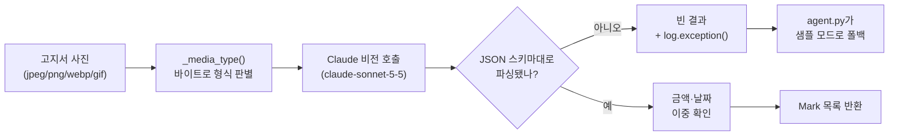

# 또박또박 — AI 고지서 해독기

코디세이 AI 네이티브 대전 **M3 AI 네이티브 Final Project 자율 주제** 팀 저장소.

## 프로젝트 소개

고지서·가정통신문·주민센터 안내문을 받고도 「그래서 뭘 해야 하는지」 모르는 사람이 많다. 한자어와 법령 인용, 본문·표·뒷면에 흩어진 기한과 금액 때문이다.
또박또박은 고지서 사진 한 장을 받아 **원본 위에** 빨강 = 낼 돈, 파랑 = 기한, 초록 = 챙길 서류를 긋고, 할 일 카드와 근거 문장을 붙여 준다.
1차 사용자는 대전의 60대 이상 어르신과 그 자녀다.

- 기획서: [docs/01-기획서.md](docs/01-기획서.md) (제출본 [PDF](docs/plan/상세기획서-또박또박.pdf))
- 기능 명세·아키텍처: [docs/02-기능명세.md](docs/02-기능명세.md)
- AI 설계: [docs/03-AI-설계.md](docs/03-AI-설계.md)

> 지금은 **뼈대 단계**다. 백엔드는 샘플 모드(가짜 고지서 1건)로 끝까지 돌아가고, 각 단계의 진짜 구현은 담당자가 자기 파일에서 채운다.
> 빈 칸은 빈 그대로 둔다 — 지어낸 결과·피드백으로 채우지 않는다.

## 팀원 및 역할

| 이름 | 역할 | 담당 업무 | 내 파일 | GitHub |
|------|------|-----------|---------|--------|
| 오주현(팀장) | PM · AI Agent | 일정·PR 리뷰·통합, Agent 4단계, 프롬프트 JSON 스키마 | `backend/app/agent.py` · `schema.py` | [@dicia-jhoh](https://github.com/dicia-jhoh) |
| 황지영 | 멀티모달 추출 | 비전 LLM 추출·파싱, 3색 좌표, 금액·날짜 이중 확인 | `backend/app/extract.py` | [@ppungee-maker](https://github.com/ppungee-maker) |
| 이정관 | Backend · 배포 · 자동화 | FastAPI, OCI 배포, n8n 기한 알림 | `backend/app/main.py` · `automation/` | [@ljk-cidy](https://github.com/ljk-cidy) |
| 송유영 | Frontend | 모바일 화면, 3색 오버레이, 할 일 카드, 손주 모드 | `web/` | [@youyu10012-glitch](https://github.com/youyu10012-glitch) |
| 김기훈 | RAG 데이터 · 품질 | 법령·정부24 수집과 근거 검색, 테스트셋 30장, 정확도·설문 | `backend/app/rag.py` · `data/testset/` | [@duplgabszin](https://github.com/duplgabszin) |
| 송유진 | UX 라이팅 · 사용자 테스트 | 쉬운 말 풀이 문체 가이드, 어르신 실사용자 테스트 진행, 시연 영상·발표 자료 | `docs/04-사용자테스트.md` · `docs/05-발표.md` | [@youjinni11](https://github.com/youjinni11) |

홈페이지의 팀 칸은 `content/members/<내 id>.js` 에서 온다 — 역할이 바뀌면 그 파일과 이 표를 같이 고친다.

## 필수 기술 요소 (2개 이상 → 4개)

| 기술 요소 | 사용 | 어디에 |
|---|---|---|
| AI Agent | ✅ | 문서 종류 판별 → 추출 → 근거 → 답장 판단, 알림 도구 호출 (`backend/app/agent.py`) |
| RAG (검색 증강 생성) | ✅ | 국가법령정보·정부24 안내를 찾아 근거로 인용 (`backend/app/rag.py`) |
| 멀티모달 AI | ✅ | 사진 속 표·도장·뒷면을 읽고 좌표까지 뽑기 (`backend/app/extract.py`) |
| 자동화 워크플로우 | ✅ | n8n 기한 D-3·D-day 알림, 손주 모드 링크 (`automation/n8n/`) |
| Long-term Memory | ☐ | 쓰지 않는다 — 고지서는 개인정보라 저장할수록 위험하다 |

## 기술 스택 — 선택과 이유

| 영역 | 선택 | 대안 | 선정 이유 |
|---|---|---|---|
| AI | 비전 LLM API + 임베딩 API | OCR 엔진 + 텍스트 LLM | 사진 이해와 좌표 추출을 한 번에 한다 |
| Backend | Python FastAPI | Flask | A 과정의 Python 그대로, 입력·출력 모양을 Pydantic 으로 고정한다 |
| RAG | Chroma | Pinecone | 설치가 가볍고 법령 문서 수천 건 규모에 충분하다 |
| Frontend | HTML · CSS · JS(모바일 우선) | React | 어르신이 앱 설치 없이 링크 하나로 연다, 빌드가 없다 |
| 배포 | OCI 서버 + systemd | Render · Vercel | 팀이 이미 쓰는 OCI 서버에 올려 화면과 API 를 주소 하나로 낸다(무료, 잠들지 않음) |
| 자동화 | n8n | 직접 짠 스케줄러 | B1-3 노코드 자동화에서 쓴 도구라 알림 흐름을 바로 짠다 |

## 시스템 아키텍처

아래 그림은 사진 한 장이 해독 결과가 되기까지의 흐름이다. 정본은 [docs/02-기능명세.md](docs/02-기능명세.md).

```
[모바일 웹 web/] ──사진──▶ [FastAPI backend/]
                              │ agent   추출(extract) → 개인정보 가림(redact) → 근거(rag) → 판별·답장 판단
                              ▼
                        Decoded JSON ──▶ 3색 표시 · 할 일 카드 · 근거 링크
                              └─ 기한 ──▶ [n8n] ──▶ D-3·D-day 알림
```

## 추출 모듈 상세 — `backend/app/extract.py` (황지영)

고지서 사진 한 장이 `Mark` 목록(3색 표시 좌표)으로 바뀌는 곳. 계약은
`def extract(image: bytes, api_key: str) -> tuple[str, list[Mark]]` 하나뿐이고,
`Mark`는 [docs/02-기능명세.md](docs/02-기능명세.md) 「데이터 모델」의 `schema.py`가 정본이다.



**동작 순서**
1. 사진 바이트의 헤더로 실제 형식(JPEG/PNG/WebP/GIF)을 판별해 `media_type`에 정확히 넣는다
   (`_media_type()`) — 하나로 고정해두면 폰 스크린샷(PNG)이 API에서 거절당한다.
2. Claude 비전에 사진을 보낸다. system prompt가 출력 형식을 JSON 스키마 하나로 강제한다
   (`document_text` 본문 전체 + `items`: `kind`(money/deadline/document)·`text`·`value`·`bbox`).
   자유 문장으로 받으면 좌표를 못 쓰므로, 스키마를 벗어나면 그대로 실패 취급한다.
3. **금액·날짜 이중 확인** — money/deadline 항목의 `value`를, 같은 호출이 돌려준
   `document_text` 본문과 정규식으로 다시 대조한다. 날짜는 `2026.10.31`(전체 숫자형)과
   `10월 31일`(연도 없는 형식, 실제 공문에 흔함) 둘 다 인식한다. 대조에서 어긋나거나
   달력에 없는 값(13월 등)이면 그 `Mark`를 아예 만들지 않고 뺀다 — 화면에서 그 칸만
   색이 안 칠해지는 게 「직접 확인 필요」 상태다. `document` 종류(챙길 서류)는 금액·날짜가
   아니라서 이중 확인 대상이 아니다.
4. 비전 호출이 실패하거나 응답이 스키마를 안 따르면 `("", [])`을 돌려준다 —
   `agent.py`가 이를 보고 자동으로 샘플 모드로 넘어간다(이 모듈은 예외를 던지지 않는다).
   실패 원인은 `log.exception()`으로 남긴다(아래 「겪은 버그」 참고).

**예시 출력** — "2026년 자동차세 납부고지서, 금 48,200원, 2026.10.31까지" 한 장을
넣으면 `extract()`가 대략 이런 걸 돌려준다(문서 전체 텍스트는 생략):
```python
(
    "2026년 자동차세 납부고지서\n납부금액: 금 48,200원\n납부기한: 2026.10.31까지\n...",
    [
        Mark(kind="money", text="금 48,200원", value="48200", bbox=[0.62, 0.18, 0.30, 0.06]),
        Mark(kind="deadline", text="2026.10.31까지", value="2026-10-31", bbox=[0.62, 0.26, 0.30, 0.06]),
    ],
)
```
`value`는 항상 다루기 쉬운 형태(금액=숫자 문자열, 날짜=`YYYY-MM-DD`)로 정규화된다 —
화면(`web/`)이나 `agent.py`의 할 일 카드 생성이 파싱을 다시 안 해도 되게 하려는 것.

**수동으로 검증해보기** — 실제 `LLM_API_KEY`가 있으면 `agent.py`/샘플 모드를 거치지 않고
이 모듈만 바로 돌려볼 수 있다.
```bash
cd backend
LLM_API_KEY=sk-... python -m app.extract <고지서사진.jpg>
```

**테스트**: `backend/tests/test_extract.py`(29건) — 실제 API 호출 없이 동작한다.
`_call_vision`을 통째로 가짜로 바꾼 파이프라인 테스트(JSON 파싱, 이중 확인, 성공/실패
경로, CLI 인자 처리)에 더해, `Anthropic` 클라이언트 자체를 가짜로 바꿔서
`messages.create`에 실제로 넘어가는 `model`·`media_type` 값까지 검증한다 — 아래 버그가
바로 그 검증이 없어서 안 잡혔던 종류다.

**겪은 버그 (이슈 [#13](https://github.com/dicia-jhoh/codyssey-m3-final/issues/13))**:
PR #9가 머지된 뒤 테스트는 전부 통과했지만, 실제 고지서 사진으로는 **검증된 적이
없었다** — `extract()`가 모든 예외를 삼키고 조용히 빈 결과를 내도록 설계돼 있어서
(샘플 모드 폴백용) 실패해도 겉으로는 멀쩡해 보일 수 있는 구조였다.
- **확인된 원인**: `media_type`이 `"image/jpeg"`로 고정돼 있어 PNG 사진이 API에서
  거절됨
- **예방 조치**: 모델 ID를 현행 `claude-sonnet-5-5`로 올림 — 옛 ID(`claude-sonnet-5`)가
  실제로 실패 원인이었는지는 미확인(공식 문서상 legacy지만 아직 Active)

PM(오주현)이 코드 리뷰에서 짚어 이슈로 올려줬고, PR #15에서 고쳤다. 실제 API 키로
돌려 본 사람은 아직 아무도 없다. 이 경험 때문에 3번(로그)과 4번(실제 호출값 검증
테스트)을 같이 추가했다 — 다음엔 같은 종류의 실패가 조용히 묻히지 않게.

**알려진 한계**: 고쳤지만 실제 `LLM_API_KEY`로 end-to-end 재검증은 아직 못 했다(위
CLI로 아무나 바로 해볼 수 있음). 김기훈의 테스트셋(`data/testset/`)이 모이면 그걸로
실제 정확도를 재야 기능 명세의 "90% 이상" 기준 충족 여부를 알 수 있다. HEIC(아이폰
기본 사진 형식)는 Claude API가 안 받아서 `_media_type()`이 명확한 에러로 거부한다
(조용히 JPEG로 속여 보내던 예전 버그는 고침) — 업로드 단계에서의 실제 변환은 아직 미구현.

관련 PR: [#9](https://github.com/dicia-jhoh/codyssey-m3-final/pull/9) 기본 구현 ·
[#10](https://github.com/dicia-jhoh/codyssey-m3-final/pull/10) 날짜 형식 보강 ·
[#11](https://github.com/dicia-jhoh/codyssey-m3-final/pull/11) 수동 검증 CLI ·
[#14](https://github.com/dicia-jhoh/codyssey-m3-final/pull/14) PR #11 base 정정 ·
[#15](https://github.com/dicia-jhoh/codyssey-m3-final/pull/15) 모델ID·이미지형식 버그 수정
(전부 merged)

## 준비물

- Python 3.11 이상 (`python3 --version` 으로 확인)
- Git, 그리고 이 저장소에 초대된 GitHub 계정(초대 메일에서 수락)
- 웹 브라우저(크롬 권장)
- LLM API 키는 **없어도 된다** — 없으면 샘플 모드로 돈다. 진짜 해독을 시험할 때만 `backend/.env` 에 넣는다(커밋 금지)

## 따라 하기

1. 저장소를 받는다. 아래 명령은 내 컴퓨터에 폴더 하나를 만든다.
   ```bash
   git clone https://github.com/dicia-jhoh/codyssey-m3-final.git
   cd codyssey-m3-final
   ```
2. 백엔드를 설치하고 테스트를 돌린다. 가상환경(`.venv`)을 만들어 이 프로젝트 전용으로 설치한다.
   ```bash
   cd backend
   python3 -m venv .venv
   source .venv/bin/activate          # Windows: .venv\Scripts\activate
   pip install -r requirements.txt
   pytest                             # 전부 passed 면 성공
   ```
3. 백엔드 서버를 띄운다. 켜 두면 http://localhost:8000/docs 에서 API 를 눌러 볼 수 있다.
   ```bash
   uvicorn app.main:app --reload
   ```
4. 브라우저로 http://localhost:8000/app/ 을 연다. 백엔드가 서비스 화면(`web/`)과 팀 홈페이지(http://localhost:8000/)도 같이 내준다. 아무 사진이나 올리면 샘플 해독 결과가 나온다.
   화면(`web/`)을 고치면 새로고침만 하면 된다 — 서버가 파일을 그대로 읽어 낸다.
5. 홈페이지만 고칠 땐 백엔드 없이 저장소 맨 위 폴더에서 띄워도 된다. http://localhost:8001 을 연다.
   ```bash
   python3 -m http.server 8001
   ```
6. 내 일을 시작한다. 브랜치를 만들고, 위 「내 파일」만 고치고, PR 을 올린다 — 자세한 규칙은 [CONTRIBUTING.md](CONTRIBUTING.md).

## 배포

배포 방법과 새 버전 올리기는 [deploy/README.md](deploy/README.md).

| 대상 | 주소 |
|---|---|
| 서비스 화면 | http://129.225.184.224:8037/app/ |
| 팀 홈페이지 | http://129.225.184.224:8037/ |

## 결과

| 산출물 | 위치 | 상태 |
|---|---|---|
| 기획서 | [docs/01-기획서.md](docs/01-기획서.md) | 확정 |
| 기능 요구 명세서·아키텍처 | [docs/02-기능명세.md](docs/02-기능명세.md) | 초안 |
| AI 설계(프롬프트·Agent·RAG) | [docs/03-AI-설계.md](docs/03-AI-설계.md) | 초안 |
| 사용자 테스트(5명 이상) | [docs/04-사용자테스트.md](docs/04-사용자테스트.md) | 설계만 |
| 발표 자료 | [docs/05-발표.md](docs/05-발표.md) | 순서만 |
| 서비스 | `backend/` · `web/` | 뼈대(샘플 모드) |
| 서비스 배포 | 위 표 · [deploy/](deploy/README.md) | OCI 배포됨(샘플 모드) |

## AI 윤리

- 모든 풀이 화면에 **「AI 풀이 — 원문을 함께 확인하세요」** 를 표시한다.
- 주민등록번호·계좌번호는 비전 LLM 이 글자를 읽은 **뒤**, 근거 찾기·화면·공유 링크로 넘기기 전에 가린다(`backend/app/redact.py`). 사진 자체는 가리기 전에 LLM 으로 간다.
- 사진 원본은 처리가 끝나면 지운다. 실물 고지서 사진은 저장소에 올리지 않는다(`data/testset/images/` 는 `.gitignore`).
- 사용자 테스트 기록에는 실명 대신 `사용자 1` 처럼 적는다.
- 이 저장소의 문서·코드 초안은 AI(Claude)가 쓰고 팀이 검토했다. 이후 AI 가 쓴 부분은 커밋·PR 에 적는다.

## 저장소 구조

```
backend/                FastAPI — app/(main·agent·schema·extract·rag·redact·sample), tests/
web/                    서비스 화면(모바일 웹, 빌드 없음) — 백엔드가 같이 내준다
deploy/                 OCI 배포(systemd 서비스 파일, 절차)
automation/n8n/         기한 알림 워크플로우
data/testset/           고지서 테스트셋 라벨(사진은 커밋하지 않는다)
docs/                   미션 산출물 문서, plan/ = 제출한 기획서 원본
index.html · assets/ · content/   팀 홈페이지(빌드 없음) — 로고 키트·사용 가이드 = assets/brand/
```

## 용어 사전

- **고지서**: 관공서·학교·공단이 보내는 납부 고지서뿐 아니라 안내문·가정통신문·신청서까지 통틀어 이 서비스에서 부르는 말
- **해독**: 고지서를 쉬운 말로 풀고 할 일(금액·기한·서류)을 뽑아내는 일
- **멀티모달**: 글자뿐 아니라 사진 같은 다른 형태의 입력도 이해하는 AI
- **RAG**: 답하기 전에 외부 문서(여기선 법령)를 찾아 근거로 붙이는 방식
- **AI Agent**: 목표를 받으면 단계를 스스로 정하고 도구를 불러 끝까지 처리하는 AI 프로그램
- **샘플 모드**: LLM 키가 없을 때 가짜 고지서 해독 결과를 돌려주는 동작. 화면에 배너로 알린다
- **FastAPI**: Python 으로 웹 API 서버를 만드는 도구
- **n8n**: 여러 서비스를 이어 자동으로 돌리는 노코드 도구
- **PR(Pull Request)**: 내 브랜치의 변경을 main 에 합쳐 달라고 요청하는 것. 기여 기록이 된다
