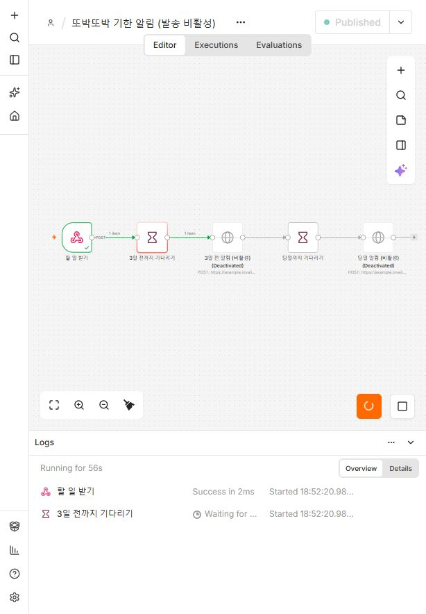

# n8n 기한 알림 — 담당: 이정관

`deadline-alert.json`: Webhook → D-3 Wait → 알림 → 당일 Wait → 알림.
워크플로우는 비활성이며 **HTTP 알림 노드 두 개도 disabled** 상태다. 키·전화번호는 포함하지 않는다.

## 가져오기

1. `docker run --rm -p 5678:5678 n8nio/n8n`으로 띄우고 http://localhost:5678 을 연다.
2. 새 워크플로우에서 **Import from File**로 `deadline-alert.json`을 가져온다.
3. Webhook의 **Listen for test event**를 누르고 아래 요청을 보낸다.
4. 실행 화면에서 「3일 전까지 기다리기」가 대기 중인지 확인한다. 알림 노드는 켜지 않는다.

```bash
curl -X POST http://localhost:5678/webhook-test/ttobak-deadline \
  -H 'Content-Type: application/json' \
  -d '{"todo_id":"00000000-0000-4000-8000-000000000001","title":"로컬 테스트","due":"2099-01-10","amount":1200,"how":"테스트","contact":""}'
```

## 백엔드 연결

`backend/.env`의 `N8N_WEBHOOK_URL`에 Webhook 주소를 넣고 `sudo systemctl restart ttobak` 한다(보내는 코드 = `backend/app/notify.py`). 비워 두면 아무것도 보내지 않는다.
테스트 주소는 수신 대기 중에만 동작한다. 운영 주소(`/webhook/ttobak-deadline`)는 워크플로우를 게시·활성화한 뒤 사용한다.
백엔드는 기한 있는 실제 해독 결과만 백그라운드로 보내며 샘플 모드는 보내지 않는다.

## 시간·발송 설정

- 기준은 **Asia/Seoul 오전 9시**다. D-3는 달력 날짜에서 3일을 뺀다.
- 지정 시각이 이미 지났으면 Wait는 즉시 통과한다. 실제 발송 전 지난 알림 처리 정책을 정해야 한다.
- 알림 URL의 `example.invalid`는 자리 표시다. 사용할 문자 서비스 요청 형식으로 바꾸고 n8n **Header Auth Credentials**를 연결한다. 키를 JSON에 적지 않는다.
- 연락처 입력 화면은 아직 없으므로 `contact`는 빈 값이다. 수신자 동의·연락처 연결 전에는 발송 노드를 켜지 않는다.
- 처리 완료에 따른 남은 알림 취소는 후속 작업이다.

참고: [Wait 노드 문서](https://docs.n8n.io/integrations/builtin/core-nodes/n8n-nodes-base.wait/).

## 실행 검증

2026-10-22, 로컬 n8n 2.44.5 / Node.js 24.19.0에서 CLI 가져오기·내보내기를 확인했다.
위 테스트 요청에 Webhook은 성공했고, 「3일 전까지 기다리기」 실행 로그는 Waiting 상태였다.
두 발송 노드는 비활성이다. 월 경계·윤년·KST 날짜 표현식 3건도 통과했다.


